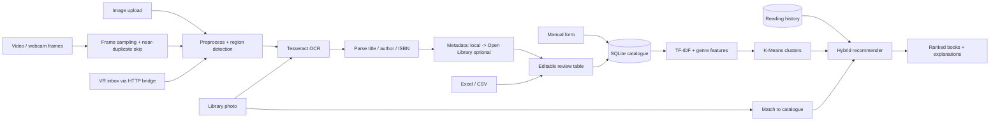
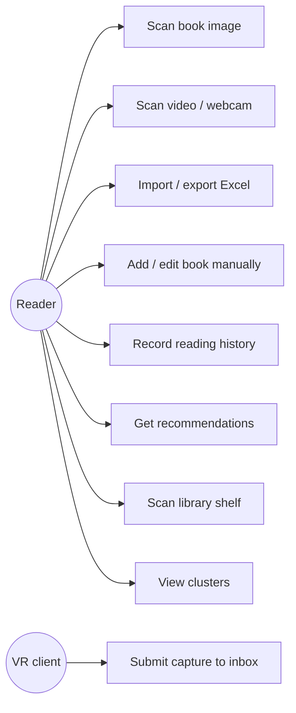
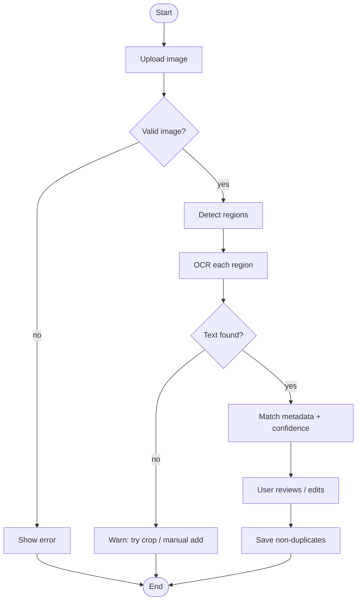
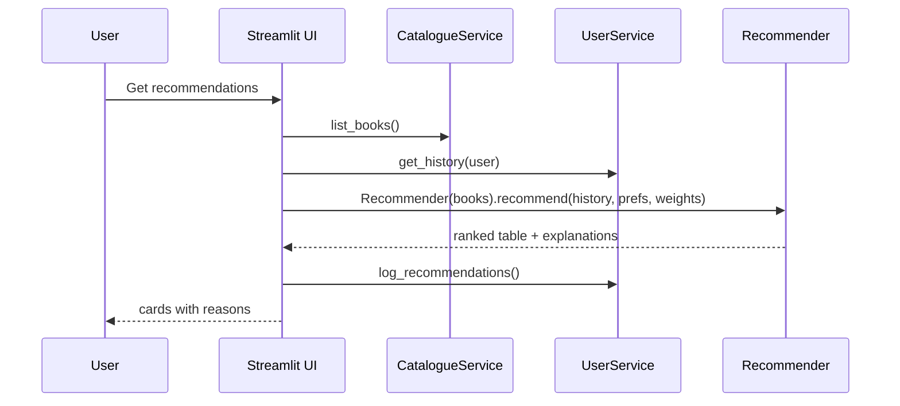
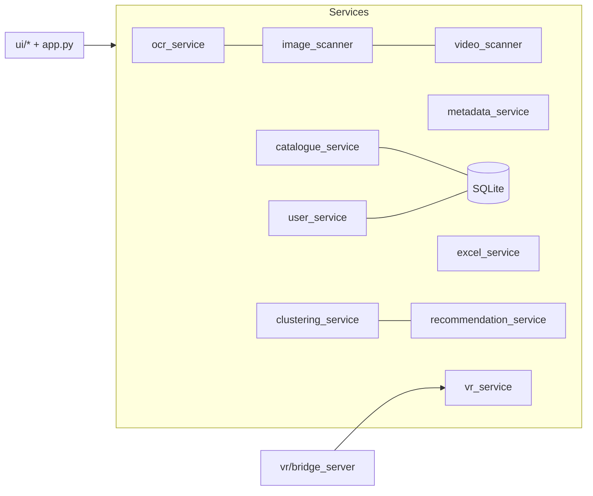

# Multimodal Intelligent Book Recommendation System Using Computer Vision, OCR, and Machine Learning

## Abstract
Readers browsing a library or bookstore cannot easily tell which of the visible books suit their taste, and book catalogues are usually built by hand. This project presents a Python/Streamlit application that collects book information through photographs, video or webcam frames, Excel/CSV files, manual entry and an optional VR input bridge. Text is extracted with Tesseract OCR after OpenCV-based preprocessing and region detection, then matched to local or Open Library metadata. All inputs feed one SQLite catalogue, kept separate from each user's reading history. An explainable hybrid recommender combines TF-IDF content similarity, genre-preference scores, K-Means theme groups, author affinity and, when enough data exist, user-based collaborative filtering. A shelf-photo mode separates books recognised in the picture, books matched to the catalogue and books recommended. Automated tests cover import/export, duplicates, OCR failure, empty data, ranking, clustering and matching. The system is a demonstrable prototype: detection is heuristic and the demonstration dataset is too small to support accuracy claims.

**Keywords:** book recommendation, OCR, computer vision, hybrid recommender, K-Means, TF-IDF, Streamlit, explainable AI.

## 1. Problem Statement
Given photographs, videos or spreadsheets of books and a user's reading history, identify the books, store them in a consistent catalogue, learn the user's preferences, and recommend suitable books — including only those visible in a photographed shelf — with a human-readable justification.

## 2. Motivation and Objectives
Motivation: manual cataloguing is slow; shelf browsing is unguided; opaque recommenders reduce trust.
Objectives: (1) multimodal book capture with human correction; (2) one persistent catalogue without silent overwrites; (3) separate reading history from scanned inventory; (4) explainable hybrid recommendation; (5) shelf-photo recommendation; (6) honest handling of uncertainty, offline use and optional VR; (7) a tested, locally runnable system.

## 3. Existing Systems and Limitations
Typical online recommenders rely on large rating matrices and give little explanation. Library catalogues require manual entry or ISBN barcodes. Generic OCR apps read text but do not link it to a personal taste model. Few student-level systems accept shelf photos and tie them to a reading profile. Limitations common to these: cold start, opaque scoring, poor handling of uncertain recognition, no unified multi-input catalogue.

## 4. Proposed System
A modular pipeline: input → region detection → OCR → parsing → metadata enrichment → editable review → catalogue (SQLite) → feature extraction → clustering/profile → hybrid ranking → explanation. Excel import/export, manual forms and a VR inbox reuse the same catalogue. Differences from existing systems: unified catalogue, uncertainty shown as a confidence value, non-destructive imports, scanned ≠ read, transparent adjustable weights.

## 5. System Architecture and Data Flow


## 6. UML Diagrams
**Use case**

**Activity (image scan)**

**Sequence (recommendation)**

**Component**


## 7. Data Schema
| Table | Columns |
|---|---|
| books | book_id (PK), title, author, genre, subgenre, isbn, description, publication_year, language, source, scan_confidence, availability, norm_title, norm_surname, timestamps |
| users | user_id (PK), name, pref_genres, pref_authors |
| reading_history | id, user_id (FK), book_id (FK), status ∈ {read, reading, interested}, rating 1–5, liked ∈ {1,0,−1}, read_date; UNIQUE(user_id, book_id) |
| recommendation_log | id, user_id, book_id, score, explanation, created_at, selected |
| scan_logs | id, timestamp, input_type, filename, items_found, items_saved, notes |

Excel workbook sheets: Book Catalogue, Reading History, Recommendations, Scan Logs.

## 8. Algorithms
**8.1 Region detection.** Shelf: Sobel-x → threshold → vertical morphological opening → column coverage profile → greedy peak picking with minimum spacing → spine segments. Covers: Canny → dilation → contours → area/aspect filter → non-maximum suppression. Fallback: whole image.
**8.2 OCR and parsing.** Region → grayscale, upscaling if small, CLAHE, denoise → Tesseract word boxes grouped into lines (rotations 90°/270° tried for tall regions, inversion if weak). Title = contiguous tallest-font lines; author = “by …” or name-shaped line; ISBN = regex + checksum.
```
function SCAN(image):
    regions = DETECT(preprocess(image))
    for r in regions:
        lines = OCR_BEST(r)                    # rotations/inversion, keep highest sum(conf*len)
        parsed = PARSE(lines)                  # title, author, isbn, ocr_conf
        meta = IDENTIFY(parsed)                # local ISBN/title/text match, else Open Library (optional)
        conf = 0.4*ocr_conf + 0.6*meta.score if meta else 0.6*ocr_conf   # >=0.9 if valid ISBN matched
        emit record(source, conf)
```
**8.3 Duplicate handling.** key = normalised title (no articles/punctuation) + author surname, or equal valid ISBN; merge fills blank fields only.
**8.4 Features and clustering.** TF-IDF (unigrams+bigrams, English stop-words) of description (title if missing) + subgenre; genre one-hot × 0.6; L2-normalised. K-Means (k ∈ [2, min(8, n−1)], best silhouette); n<4 or indistinguishable books → one cluster. Limitation: sparse short texts; clusters describe books, not reader interest.
**8.5 Recommendation.**
```
profile  = signed weights per history row (read 5★ 1.0 … 1★ −0.5; reading 0.7; interested 0.5)
taste    = Σ weight_i · tfidf_i ;  content = cos(tfidf_candidate, taste) / max over candidates
genre    = Σ weights per genre (+0.5 prior per chosen genre) / max
cluster  = positive weight mass in candidate's cluster / max
author   = 1 if user liked another book by that author
collab   = user-based cosine CF (only if ≥5 users, ≥3 signals each, overlap exists)
score    = Σ w_c · component_c   (weights renormalised; collab weight 0 if unavailable)
exclude  = read, reading, disliked (optional)  ->  rank  ->  explain top-2 contributing components
```
**8.6 Library photo mode.** detect → OCR → fuzzy match each record to catalogue (ISBN exact; title similarity, containment, author blend; ≥0.80 matched, 0.65–0.80 uncertain) → recommend only among matched IDs when selected.

## 9. Implementation Details
Python 3.12, Streamlit UI (`ui/` modules), OpenCV/Pillow, pytesseract, pandas/NumPy, scikit-learn, openpyxl, SQLite, Plotly. External access is optional (Open Library with a 5 s timeout and a circuit breaker). See README for layout, setup and design decisions.

## 10. Test Cases and Actual Results
Command: `python -m unittest discover -s tests -t . -v`, executed in the build environment (Python 3.12, Linux, Tesseract present, Streamlit not installed).
**Result: 64 tests run, 63 passed, 0 failed, 1 skipped (real-Streamlit UI test `tests/test_ui_smoke.py`), ≈17 s.**
| Area | Representative checks |
|---|---|
| Excel | template round-trip; 4 sheet names; aliases; missing/blank titles; in-file duplicates; invalid ISBN; corrupt, unsupported and CSV files; history import; non-destructive import |
| Missing/malformed data | blank/NaN titles rejected; year/confidence/ISBN coercion |
| Duplicates | case/article/punctuation/author-format variants; ISBN duplicate; merge never overwrites |
| OCR failure | Tesseract unavailable (mocked); per-region engine error; blank image; unreadable lines |
| Empty data | empty catalogue, history, recommender, clusters, evaluation |
| Ranking | read/disliked excluded; ordering; weights normalised; genre filter; candidate restriction; cold-start; starter picks; collaborative gating |
| Clustering | 0/1/3 books; identical books; missing descriptions; sample data k≥2, forced k |
| Library matching | noisy titles; unknown titles unmatched; ISBN exact; recommendation restricted to photographed subset; synthetic three-cover photo end-to-end |
| Invalid files | corrupt/unsupported images, videos, spreadsheets, VR payloads |
| Video / VR | frame skipping, cross-frame de-duplication, synthetic video end-to-end, HTTP bridge round trip |
Additional manual verification in the build environment: all ten page `render()` functions executed against empty and populated databases through a stub Streamlit harness (not a substitute for a browser test). **Not verified:** real-browser behaviour (webcam widget, uploads, layout), real shelf photographs, real headset capture.

## 11. Evaluation Methodology
The bundled data are a **demonstration dataset** (52 books, 5 hand-written users). Running the built-in leave-one-out check (`evaluate_leave_one_out`, Analytics page) on it gave 25 hold-out cases, HitRate@5 = 0.88 and MRR = 0.40 against a 52-book pool. These figures only show that the code runs end to end: the users are few, strongly genre-consistent and written by the authors, with no baselines, so they are **not evidence of accuracy**. A valid experiment requires (a) real interaction logs from many readers, (b) a time- or user-based train/test split without onboarding leakage, (c) baselines (random, popularity, genre-only), (d) metrics such as Precision@k, Recall@k, NDCG@k, MRR with confidence intervals, and (e) for OCR, a labelled image set reporting title-exact-match and character error rate by photo condition.

## 12. Limitations and Future Enhancements
Limitations: heuristic detection; OCR sensitive to glare/curvature/stylised fonts; synthetic-image testing; tiny sample data; offline metadata limited to catalogue and sample; availability unknown unless entered; VR path untested on hardware.
Future: trained spine/book detector, barcode/ISBN decoding, embedding-based text features, implicit-feedback models, larger real dataset and formal study, multi-language OCR, integration with library catalogue APIs, native Quest passthrough client.

## 13. Conclusion
The project delivers an integrated, locally runnable prototype in which all input modes share one catalogue and an explainable recommender, with careful handling of uncertainty, duplicates, offline use and scope limits. Its value is as a transparent engineering baseline; claims about real-world accuracy would require the evaluation described in §11.

## References
*Every entry is a real publication to the best of my knowledge, but details (volume/pages/year) must be checked against the publisher before citing. No recent (2022+) IEEE papers are listed because I could not verify specific titles/DOIs offline — search IEEE Xplore for “book spine recognition OCR”, “library shelf book detection”, “hybrid book recommender system” and add verified results.*
1. R. Smith, “An Overview of the Tesseract OCR Engine,” in Proc. 9th Int. Conf. Document Analysis and Recognition (ICDAR), 2007. *(IEEE — verify pages)*
2. Y. Koren, R. Bell, C. Volinsky, “Matrix Factorization Techniques for Recommender Systems,” IEEE Computer, vol. 42, no. 8, 2009. *(verify pages)*
3. G. Adomavicius, A. Tuzhilin, “Toward the Next Generation of Recommender Systems: A Survey of the State-of-the-Art and Possible Extensions,” IEEE Trans. Knowledge and Data Engineering, vol. 17, no. 6, 2005. *(verify pages)*
4. S. P. Lloyd, “Least Squares Quantization in PCM,” IEEE Trans. Information Theory, vol. 28, no. 2, 1982. *(verify pages)*
5. P. J. Rousseeuw, “Silhouettes: A Graphical Aid to the Interpretation and Validation of Cluster Analysis,” J. Computational and Applied Mathematics, vol. 20, 1987. *(verify pages)*
6. G. Salton, C. Buckley, “Term-Weighting Approaches in Automatic Text Retrieval,” Information Processing & Management, vol. 24, no. 5, 1988. *(verify pages)*
7. B. Sarwar, G. Karypis, J. Konstan, J. Riedl, “Item-Based Collaborative Filtering Recommendation Algorithms,” Proc. WWW, 2001. *(verify)*
8. F. Pedregosa et al., “Scikit-learn: Machine Learning in Python,” J. Machine Learning Research, vol. 12, 2011. *(verify pages)*
9. G. Bradski, “The OpenCV Library,” Dr. Dobb’s Journal of Software Tools, 2000. *(verify)*
